# m5stack-firmware

English | [简体中文](README.zh-CN.md)

[](https://github.com/pocket-nexus/m5stack-firmware/actions/workflows/firmware.yml)
[](https://github.com/pocket-nexus/m5stack-firmware/releases)
[](LICENSE)

Firmware for five M5Stack boards whose user interface is a TypeScript
application built with [PocketJS](https://github.com/pocket-nexus/pocketjs).
The Tab5, StopWatch, CoreP4X and AtomS3 programs recreate the board's
factory demo;
the StickS3 program runs seven demos of the board's sensors, keys and audio.
Each application is one set of Solid TSX views and TypeScript models that
builds in two modes:

- **JS mode** (default): the application is compiled to a bundle and runs in
  the QuickJS guest on the device.
- **AOT mode**: [MicroTS](https://github.com/pocket-nexus/pocketjs/tree/main/microts)
  compiles the same sources to Rust, linked into the firmware without a
  JavaScript engine.

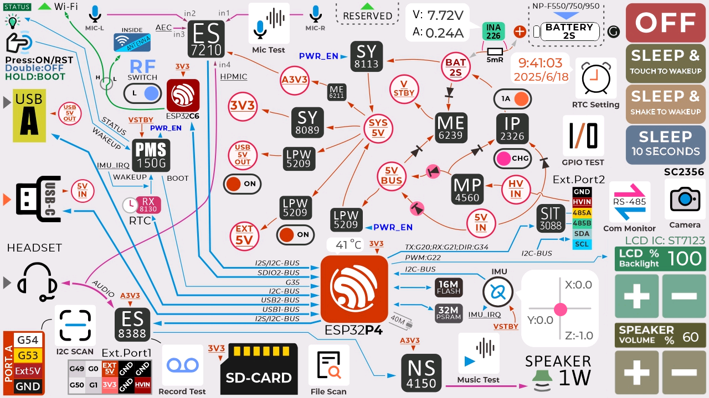

## Contents

- [Supported boards](#supported-boards)
- [Screenshots](#screenshots)
- [JS mode and AOT mode](#js-mode-and-aot-mode)
- [Flash a release image](#flash-a-release-image)
- [Build from source](#build-from-source)
- [Preview without a board](#preview-without-a-board)
- [How it works](#how-it-works)
- [Repository layout](#repository-layout)
- [Known limits](#known-limits)
- [Documentation](#documentation)
- [Contributing](#contributing)
- [License](#license)

## Supported boards

| Board | SoC and memory | Display | Application | Modes |
| --- | --- | --- | --- | --- |
| [Tab5](programs/tab5/README.md) | ESP32-P4 (+ ESP32-C6 radio), 32 MB PSRAM, 16 MB flash | 5" 720×1280 MIPI-DSI, touch; UI in landscape | [Factory demo](apps/tab5-factory/README.md): startup animation, launcher, 15 panel windows | JS, AOT |
| [StopWatch](programs/stopwatch/README.md) (C152) | ESP32-S3, 8 MB PSRAM, 16 MB flash | 1.75" 466×466 round AMOLED, touch | [Factory demo](apps/stopwatch-factory/README.md): launcher and the nine applications it opens | JS, AOT |
| [StickS3](programs/sticks3/README.md) (K150) | ESP32-S3, 8 MB PSRAM, 8 MB flash | 1.14" 135×240 IPS | [Board demos](apps/sticks3-demos/README.md): marble maze, dice, reaction timer, snake, spirit level, sound meter, metronome | JS, AOT |
| [CoreP4X](programs/corep4x/README.md) (C157) | ESP32-P4 (chip revision 3), 32 MB PSRAM, 16 MB flash | 2.64" 480×480 MIPI-DSI, touch | [Factory demo](apps/corep4x-factory/README.md): startup, info and function screens, 14 function windows | JS, AOT |
| [AtomS3, AtomS3R](programs/atoms3/README.md) | ESP32-S3, no PSRAM, 8 MB flash (AtomS3R: 8 MB PSRAM, not used) | 0.85" 128×128 IPS | [Factory demo](apps/atoms3-factory/README.md): Wi-Fi, I2C, UART, PWM, ADC, IR and IMU functions | AOT only |

JS mode is the default for every board except the AtomS3. With 512 KB of
SRAM and no PSRAM, the AtomS3 runs out of internal RAM while the QuickJS
guest boots, so its program builds AOT mode only
([measurements](programs/atoms3/README.md#memory-budget)). The same image
runs on the AtomS3R: the board support reads the chip package at boot and
uses the AtomS3R's pins, backlight and IMU. AtomS3R units with an ST7735S
panel are not supported.

The factory demos are recreated from M5Stack's sources:
[M5Tab5-UserDemo](https://github.com/m5stack/M5Tab5-UserDemo),
[M5StopWatch-UserDemo](https://github.com/m5stack/M5StopWatch-UserDemo),
[M5CoreP4X-UserDemo](https://github.com/m5stack/M5CoreP4X-UserDemo) and
[M5AtomS3-UserDemo](https://github.com/m5stack/M5AtomS3-UserDemo). Each
application README lists the factory screens it reproduces and every known
difference from the factory firmware.

## Screenshots

The PocketJS simulator renders these from the JS bundles at each board's
resolution; without a board the applications simulate the sensor values.
`bun tools/screenshots.ts` regenerates them ([Preview without a
board](#preview-without-a-board)).

### Tab5

| RTC setting | I2C scan | Ext.Port1 and MBUS GPIO test |
| :---: | :---: | :---: |
| 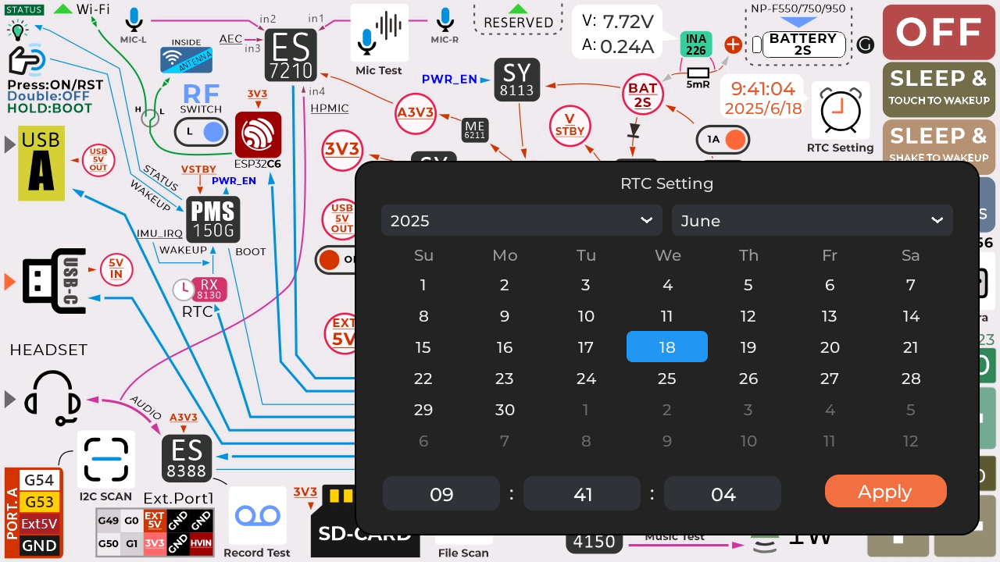 | 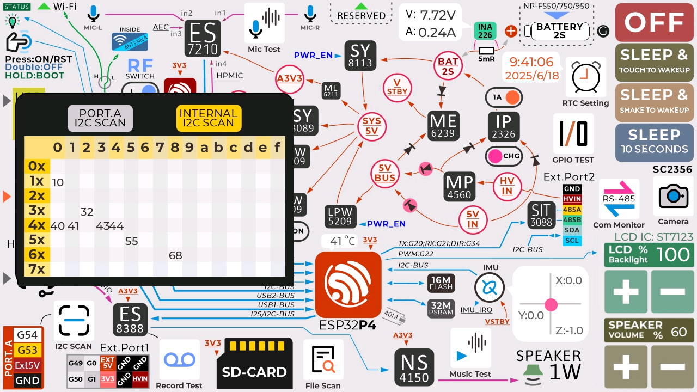 | 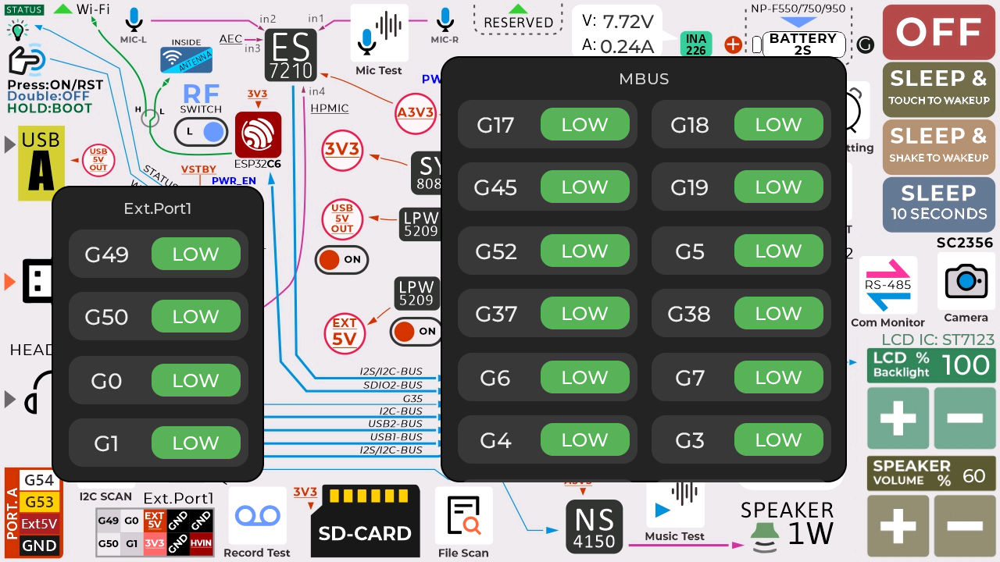 |

### StopWatch

| Launcher | Classic watch face | Number flow watch face |
| :---: | :---: | :---: |
| 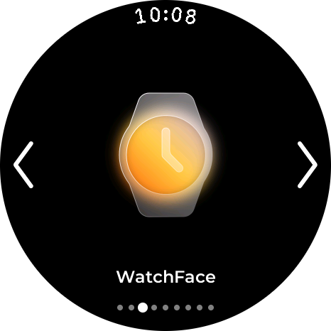 | 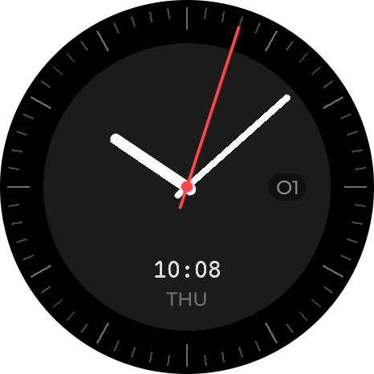 | 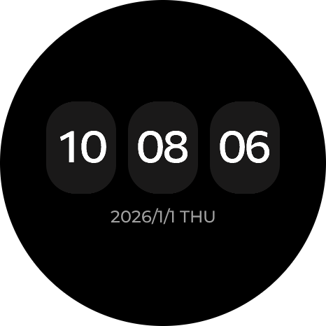 |
| **Big number watch face** | **Stopwatch with laps** | **Lucky wheel** |
|  | 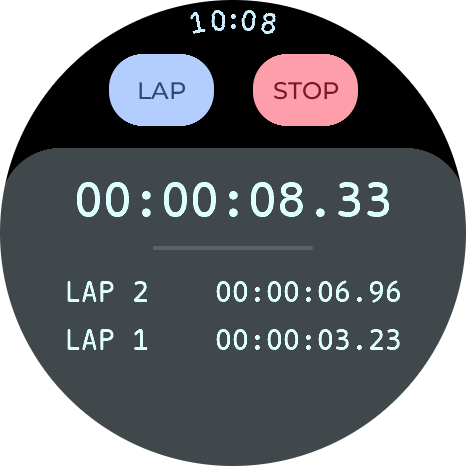 | 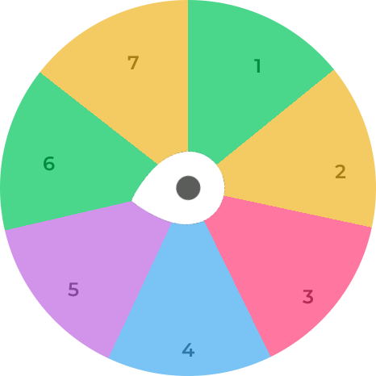 |

### StickS3

| Home | Marble Maze | Dice | Snake | Spirit Level | Sound Meter | Metronome |
| :---: | :---: | :---: | :---: | :---: | :---: | :---: |
| 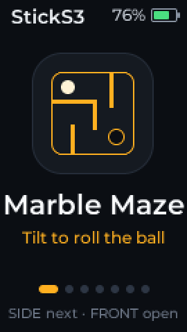 | 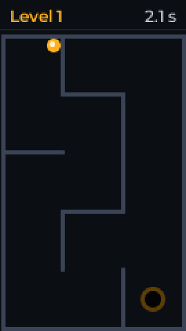 | 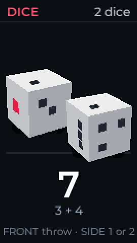 | 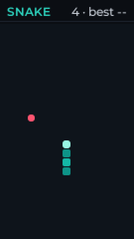 | 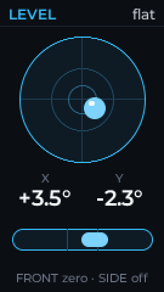 | 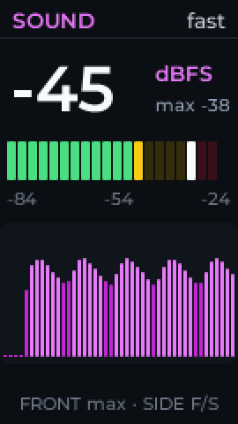 | 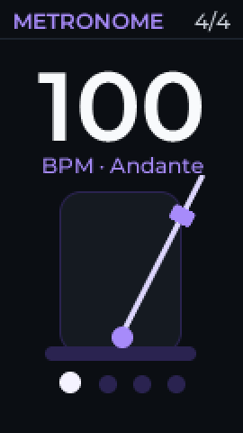 |

### CoreP4X

| Function screen | POWER | TIMER | MUSIC | IR TX/RX |
| :---: | :---: | :---: | :---: | :---: |
| 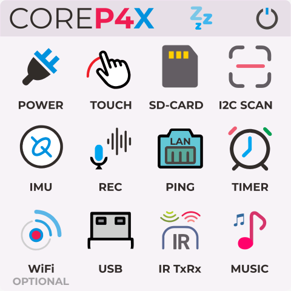 | 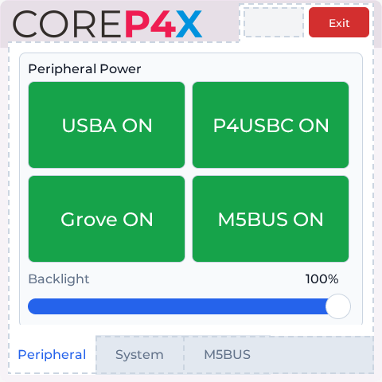 | 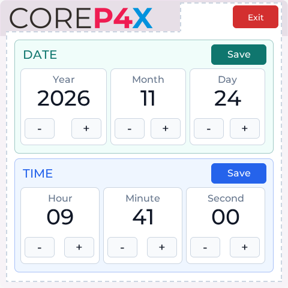 | 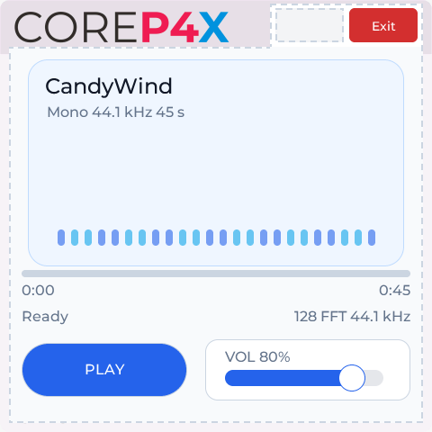 | 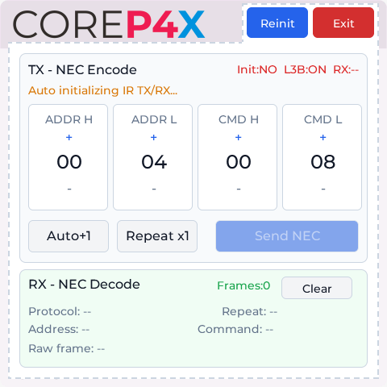 |

### AtomS3

| Menu | Wi-Fi scan | I2C scan | UART monitor | PWM | IMU |
| :---: | :---: | :---: | :---: | :---: | :---: |
|  | 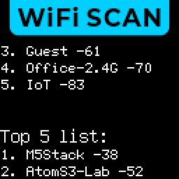 | 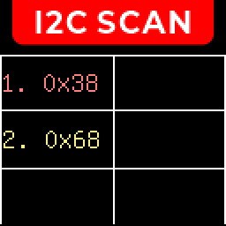 | 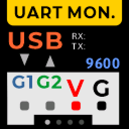 | 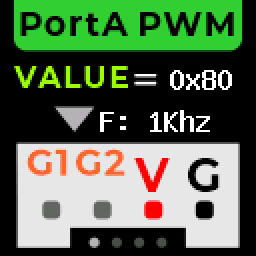 | 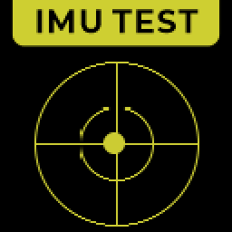 |

## JS mode and AOT mode

Both modes build from the same `apps/<board>-*/` sources, draw with the same
PocketJS Rust core and use the same board code. Kconfig selects the mode:
`CONFIG_M5_POCKET_APP_MODE_JS` (the default) or
`CONFIG_M5_POCKET_APP_MODE_AOT`, which each program's `sdkconfig.aot` sets.

| | JS mode | AOT mode (MicroTS) |
| --- | --- | --- |
| What the firmware contains | A bundle (`.pkb`: JavaScript and an asset pack) and the QuickJS engine | Rust code that MicroTS generated from the views and models; no JavaScript engine, no bundle |
| How the application runs | QuickJS interprets the bundle; the PocketJS core lays out and draws | The compiled application calls the PocketJS core directly |
| Board values and requests (`device.ts`) | `main.tsx` connects `globalThis.m5`, which calls the `device.ts` host functions every frame | The program's AOT crate writes the `device.ts` fields through generated accessors |
| Touch | The framework's tap recognizer | The host turns a contact into a press of the focusable view under it; no gesture or scroll events |
| Images | In the bundle's asset pack | Baked into flash; decoded on first draw or copied to the heap at start, per program |
| Memory | QuickJS heap, from PSRAM on the boards that have it (StickS3 4 MiB, StopWatch 6 MiB, CoreP4X 16 MiB, Tab5 24 MiB limits) | No QuickJS heap; runs without PSRAM |
| Build | `pocket compile` writes the bundle; the PocketJS runtime archive is built from source | `pocket compile --aot` generates Rust; Cargo builds the program's `aot/` crate |
| Runs in the PocketJS simulator and browser host | Yes, the same bundle | No; preview the JS build of the same sources |

**Choosing a mode.** The JS bundle runs unchanged in the PocketJS simulator
and browser host, which suits iterating on the interface. AOT mode gives
smaller images, needs no JavaScript heap and is the only mode that fits the
AtomS3.

**Source rules.** The application sources stay inside the MicroTS admission
subset so that both modes build: models are TypeScript state modules with
typed top-level fields and synchronous functions, and views are Solid TSX
within the
[MicroTS Solid subset](https://github.com/pocket-nexus/pocketjs/blob/618c1ba971d447944b19a48d308059c0aec5d7cf/site/content/docs/microts-solid.md).
Gestures such as drags and swipes are model code that reads the `pointerX`,
`pointerY` and `pointerDown` fields the host publishes, so they behave the
same in both modes. Check a change against the subset without building
firmware:

```sh
bun run pocket compile --config apps/stopwatch-factory/pocket.host.config.ts --aot --out /tmp/stopwatch-aot
```

[docs/APP-HOST.md](docs/APP-HOST.md) describes how the host runs each mode
and how a program's AOT crate is built.

## Flash a release image

Each [release](https://github.com/pocket-nexus/m5stack-firmware/releases) has
one merged flash image per board and mode,
`m5stack-firmware-<board>-<js|aot>-<version>.bin`, holding the bootloader, the
partition table and the application. Write it at offset 0x0 with
[esptool](https://github.com/espressif/esptool):

```sh
esptool --chip esp32p4 write-flash 0x0 m5stack-firmware-tab5-js-v0.1.3.bin       # Tab5
esptool --chip esp32s3 write-flash 0x0 m5stack-firmware-stopwatch-aot-v0.1.3.bin # StopWatch
esptool --chip esp32s3 write-flash 0x0 m5stack-firmware-sticks3-js-v0.1.3.bin    # StickS3
esptool --chip esp32s3 write-flash 0x0 m5stack-firmware-atoms3-aot-v0.1.3.bin    # AtomS3, AtomS3R
esptool --chip esp32p4 write-flash 0x0 m5stack-firmware-corep4x-js-<version>.bin  # CoreP4X
```

Releases after 0.1.3 also carry the CoreP4X images.

[CHANGELOG.md](CHANGELOG.md) lists the images and the changes of each
version.

## Build from source

### Requirements

| Tool | Version | Used for |
| --- | --- | --- |
| [ESP-IDF](https://docs.espressif.com/projects/esp-idf/) | `>=6.0,<6.3` (CI uses 6.2) | Firmware |
| [Bun](https://bun.sh) | the version in `.bun-version` | Pocket CLI, bundles, git hooks |
| Rust through [rustup](https://rustup.rs) | 1.98.1 with `riscv32imafc-unknown-none-elf` and `wasm32-unknown-unknown` | PocketJS runtime and AOT library for ESP32-P4; MicroTS layout oracle (AOT builds, simulator) |
| Espressif Rust toolchain `esp` ([espup](https://github.com/esp-rs/espup)) | Xtensa Rust 1.97.0.0 | PocketJS runtime and AOT library for ESP32-S3 |

Both modes need Rust: the firmware builds the PocketJS runtime from the
submodule's sources. The build looks for the Xtensa toolchain as the rustup
toolchain `esp` (`~/.rustup/toolchains/esp`), where
`espup install --toolchain-version 1.97.0.0` installs it.

```sh
rustup toolchain install 1.98.1 --target riscv32imafc-unknown-none-elf --target wasm32-unknown-unknown
espup install --toolchain-version 1.97.0.0     # ESP32-S3 boards
```

### Clone and install

```sh
git clone --recurse-submodules https://github.com/pocket-nexus/m5stack-firmware.git
cd m5stack-firmware
bun install                 # JavaScript dependencies and git hooks
. $IDF_PATH/export.sh
```

### Build and flash

| Board | Directory | IDF target | Modes |
| --- | --- | --- | --- |
| Tab5 | `programs/tab5` | `esp32p4` | JS, AOT |
| StopWatch | `programs/stopwatch` | `esp32s3` | JS, AOT |
| StickS3 | `programs/sticks3` | `esp32s3` | JS, AOT |
| CoreP4X | `programs/corep4x` | `esp32p4` | JS, AOT |
| AtomS3 | `programs/atoms3` | `esp32s3` | AOT (the default of its `sdkconfig.defaults`) |

JS mode, build directory `build/`:

```sh
cd programs/<board>
idf.py set-target <target> build
idf.py -p <port> flash monitor
```

AOT mode, build directory `build-aot/`:

```sh
cd programs/<board>
idf.py -B build-aot -DSDKCONFIG=build-aot/sdkconfig \
    -DSDKCONFIG_DEFAULTS="sdkconfig.defaults;sdkconfig.aot" set-target <target> build
idf.py -B build-aot -DSDKCONFIG=build-aot/sdkconfig -p <port> flash monitor
```

For the AtomS3 the `build/` commands build AOT mode: its
`sdkconfig.defaults` selects it, and it has no `sdkconfig.aot`. Notes:

- The first AOT build runs `bun tools/wasm.ts` in `third_party/pocketjs` to
  build the MicroTS layout oracle (`pocketjs.wasm`, an ignored output).
- JS and AOT builds of one program share `managed_components/` and use
  different lock files (`dependencies.lock`, `dependencies.aot.lock`): run
  them one after the other, not at the same time.
- MicroTS generates a Rust module of about 100 MB for the StopWatch AOT
  build. rustc needs more than 10 GB of memory for it; the CI job adds an
  8 GB swap file and takes about 25 minutes.
- After switching the mode in `menuconfig`, run `idf.py reconfigure`.

Each program README has the board's pins, the partition table and the
measured sizes.

## Preview without a board

The JS bundles run in the PocketJS simulator (the wasm core), which renders
the screenshots above:

```sh
(cd third_party/pocketjs && bun tools/wasm.ts)   # once: builds the wasm core
bun tools/screenshots.ts                         # all boards, or: tab5 stopwatch sticks3 atoms3 corep4x
```

The tool compiles each application into `.pocket-build/screenshots/`, drives
a scripted tour and writes `docs/images/<board>-<screen>.png`. Without a
board each application simulates its device values; a stand-in for the
host's `globalThis.m5` delivers the key and sensor values the tour sets.

## How it works

```text
apps/<board>-*/            TSX views, TS models, device.ts, fonts, images
      │
      ├─ JS mode:  tools/pocket compile ──────► bundle (.pkb) ─► QuickJS guest ─┐
      └─ AOT mode: tools/pocket compile --aot ► Rust ─► programs/<board>/aot ───┤
                                                                                ▼
platforms/esp-idf/m5_pocket_app    application host: display, renderer, input,
      │                            frame loop, device bridge
programs/<board>/main              board bring-up, sensor publishing, request handling
      │
platforms/esp-idf/m5_bsp_<board>   board support taken from M5Stack sources
```

- **Board support** (`m5_bsp_<board>`) brings up power, buses, the panel,
  touch, keys, sensors and audio and returns ESP-IDF handles. It does not
  depend on PocketJS.
- **The application host** (`m5_pocket_app`) wraps the panel and inputs in
  PocketJS display and input drivers, runs the application in the selected
  mode on its own task and calls the program's hooks before and after each
  frame.
- **The device bridge** carries values by name: the program publishes
  `m5_pocket_bridge_set_number("batteryLevel", 76)` and the application reads
  the `device.ts` field `batteryLevel`. The application sends requests as
  strings, such as `request("brightness 80")`, which the program's
  `on_request` hook handles.

## Repository layout

```text
apps/                     the five applications (TSX/TS sources, fonts, images)
programs/<board>/         ESP-IDF projects: main, sdkconfig.defaults, partitions, AOT crate
platforms/esp-idf/        board support components and the shared application host
platforms/rust/           shared Rust crates of the AOT mode
third_party/pocketjs/     PocketJS (git submodule)
tests/                    aot-smoke program (both modes, both targets), font checks
tools/                    Pocket CLI launcher, formatter, screenshots, frame profiler
docs/                     reference documentation
```

`third_party/pocketjs` is pinned to commit `618c1ba9` of
[pocket-nexus/pocketjs](https://github.com/pocket-nexus/pocketjs), after the
`v0.17.0` release.

## Known limits

- Tab5: no camera preview (the camera window stays black), Wi-Fi access
  point (the window shows the factory text) or USB-A host.
- StopWatch: no Wi-Fi station or Wi-Fi setup access point (the badge
  editor runs its own access point); FluidBox simulates 48 particles instead
  of the factory's 450. The JS image does not start on the board
  ([programs/stopwatch](programs/stopwatch/README.md#validation)): flash the
  AOT image.
- CoreP4X: no Wi-Fi (the optional ESP32-C6 module is not driven; the window
  says so) and no USB host (the USB window reports it).
- PocketJS bakes fonts at a fixed set of sizes (10 to 54 px), so factory text
  at other sizes uses the nearest size or is drawn from the factory's glyph
  bitmaps ([docs/FONTS.md](docs/FONTS.md)).

## Documentation

| Document | Content |
| --- | --- |
| [docs/STRUCTURE.md](docs/STRUCTURE.md) | Repository structure and ownership |
| [docs/APP-HOST.md](docs/APP-HOST.md) | Application host: JS and AOT modes, C API, device bridge, AOT crates |
| [docs/FONTS.md](docs/FONTS.md) | Per-application font faces, sizes and atlas budgets |
| `programs/<board>/README.md` | Board facts, composition, build commands, sizes |
| `apps/<app>/README.md` | Screens, controls, device bridge fields, differences from the factory firmware |
| `platforms/esp-idf/m5_bsp_<board>/README.md` | Board support and the M5Stack sources it is taken from |

## Contributing

Issues and pull requests are welcome. [AGENTS.md](AGENTS.md) holds the
engineering conventions; the main points:

- Commit messages follow Conventional Commits, `type(scope): summary`, with
  the directory as the scope (`feat(stopwatch-factory): ...`). `bun install`
  installs the git hooks (lefthook): commitlint on the message, clang-format
  on staged C and C++ files.
- C and C++ are formatted with the clang-format version pinned in
  `package.json`; run `bun run format:check` before pushing.
- Application sources stay inside the MicroTS subset, so that both modes
  build.
- Changes to PocketJS land upstream in
  [pocket-nexus/pocketjs](https://github.com/pocket-nexus/pocketjs); this
  repository then bumps the submodule.
- A pull request states how it was validated: commands, results and, for
  device runs, the board revision.

## License

[MIT](LICENSE). Files derived from M5Stack, Espressif and Bosch Sensortec
sources keep their original copyright and license (MIT, Apache-2.0,
BSD-2-Clause, BSD-3-Clause). The fonts carry their own licenses next to them in
`apps/<app>/fonts/`: Montserrat, Maple Mono and Commissioner (SIL Open Font
License 1.1) and efont (BSD-style).
