# m5stack-firmware

[English](README.md) | 简体中文

[](https://github.com/pocket-nexus/m5stack-firmware/actions/workflows/firmware.yml)
[](https://github.com/pocket-nexus/m5stack-firmware/releases)
[](LICENSE)

这是四块 M5Stack 开发板的固件，界面是用
[PocketJS](https://github.com/pocket-nexus/pocketjs) 编写的 TypeScript 应用。
Tab5、StopWatch 和 AtomS3 的程序复刻了各自的出厂演示；StickS3 的程序是七个演示，
用到板上的传感器、按键和音频。每个应用都是一套 Solid TSX 视图加 TypeScript
模型，可以用两种模式构建：

- **JS 模式**（默认）：应用编译为 bundle，在设备上的 QuickJS guest 中运行。
- **AOT 模式**：[MicroTS](https://github.com/pocket-nexus/pocketjs/tree/main/microts)
  把同一份源码编译为 Rust，链接进固件，不包含 JavaScript 引擎。

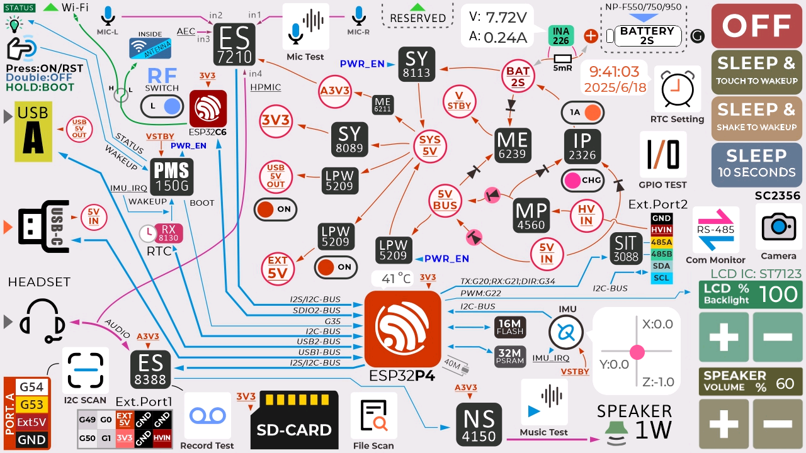

## 目录

- [支持的开发板](#支持的开发板)
- [应用截图](#应用截图)
- [JS 模式与 AOT 模式](#js-模式与-aot-模式)
- [烧录发布的固件](#烧录发布的固件)
- [从源码构建](#从源码构建)
- [无开发板预览](#无开发板预览)
- [工作原理](#工作原理)
- [仓库结构](#仓库结构)
- [已知限制](#已知限制)
- [文档](#文档)
- [参与贡献](#参与贡献)
- [许可证](#许可证)

## 支持的开发板

| 开发板 | SoC 与存储 | 屏幕 | 应用 | 模式 |
| --- | --- | --- | --- | --- |
| [Tab5](programs/tab5/README.md) | ESP32-P4（+ ESP32-C6 无线），32 MB PSRAM，16 MB flash | 5 英寸 720×1280 MIPI-DSI，触摸；界面横屏 | [出厂演示](apps/tab5-factory/README.md)：启动动画、启动器、15 个面板窗口 | JS、AOT |
| [StopWatch](programs/stopwatch/README.md)（C152） | ESP32-S3，8 MB PSRAM，16 MB flash | 1.75 英寸 466×466 圆形 AMOLED，触摸 | [出厂演示](apps/stopwatch-factory/README.md)：启动器及其打开的九个应用 | JS、AOT |
| [StickS3](programs/sticks3/README.md)（K150） | ESP32-S3，8 MB PSRAM，8 MB flash | 1.14 英寸 135×240 IPS | [板载功能演示](apps/sticks3-demos/README.md)：弹珠迷宫、骰子、反应计时、贪吃蛇、水平仪、声音计、节拍器 | JS、AOT |
| [AtomS3、AtomS3R](programs/atoms3/README.md) | ESP32-S3，无 PSRAM，8 MB flash（AtomS3R：8 MB PSRAM，未使用） | 0.85 英寸 128×128 IPS | [出厂演示](apps/atoms3-factory/README.md)：Wi-Fi、I2C、UART、PWM、ADC、红外和 IMU 功能 | 仅 AOT |

除 AtomS3 外，所有开发板默认使用 JS 模式。AtomS3 只有 512 KB SRAM、没有
PSRAM，QuickJS guest 启动时会耗尽内部 RAM，因此它的程序只构建 AOT 模式
（[测量数据](programs/atoms3/README.md#memory-budget)）。同一个镜像也能在 AtomS3R
上运行：板级支持在启动时读取芯片封装，改用 AtomS3R 的引脚、背光和 IMU。使用
ST7735S 屏幕的 AtomS3R 不在支持范围内。

出厂演示依据 M5Stack 的源码复刻：
[M5Tab5-UserDemo](https://github.com/m5stack/M5Tab5-UserDemo)、
[M5StopWatch-UserDemo](https://github.com/m5stack/M5StopWatch-UserDemo) 和
[M5AtomS3-UserDemo](https://github.com/m5stack/M5AtomS3-UserDemo)。每个应用的
README 列出了它复刻的出厂界面，以及与出厂固件的全部已知差异。

## 应用截图

以下截图由 PocketJS 模拟器按各开发板的分辨率渲染 JS bundle 得到；没有开发板时，
应用会模拟传感器数值。`bun tools/screenshots.ts` 可以重新生成这些截图
（见[无开发板预览](#无开发板预览)）。

### Tab5

| RTC 设置 | I2C 扫描 | Ext.Port1 与 MBUS GPIO 测试 |
| :---: | :---: | :---: |
| 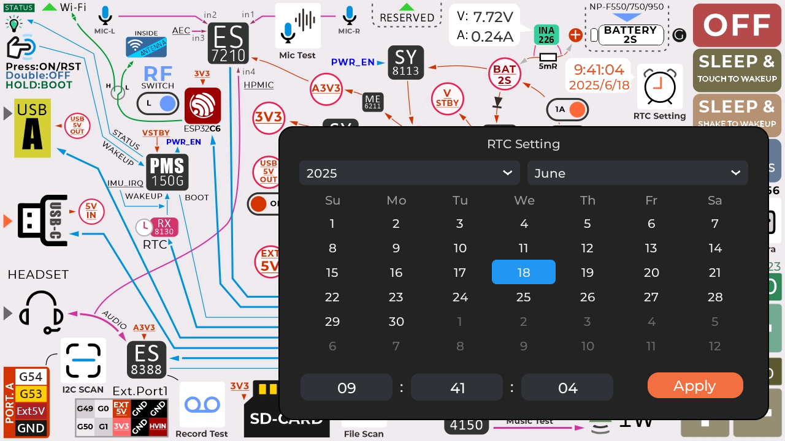 | 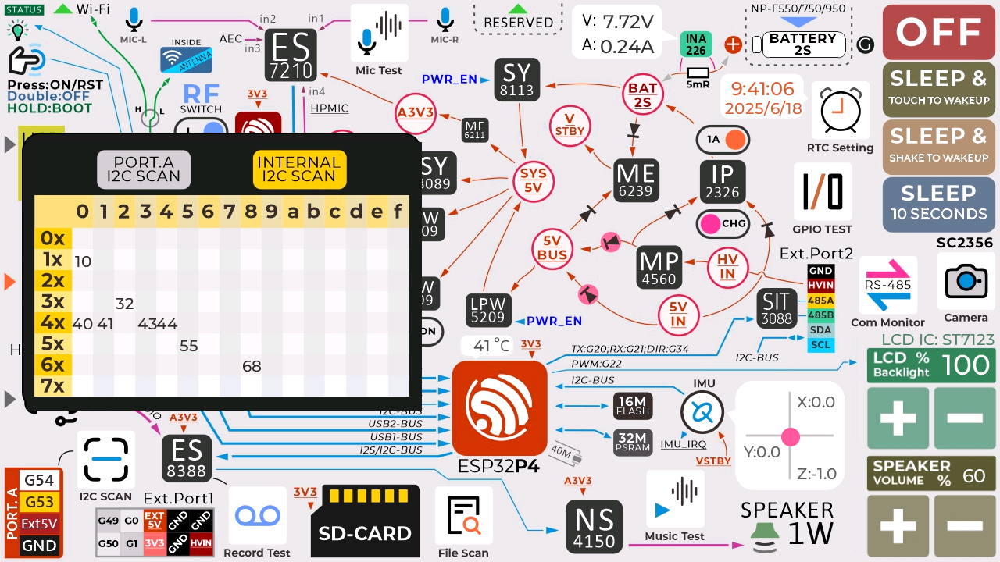 | 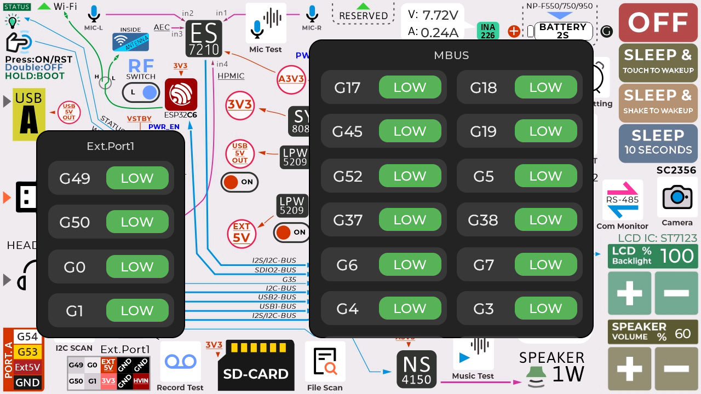 |

### StopWatch

| 启动器 | 经典表盘 | 数字翻滚表盘 |
| :---: | :---: | :---: |
| 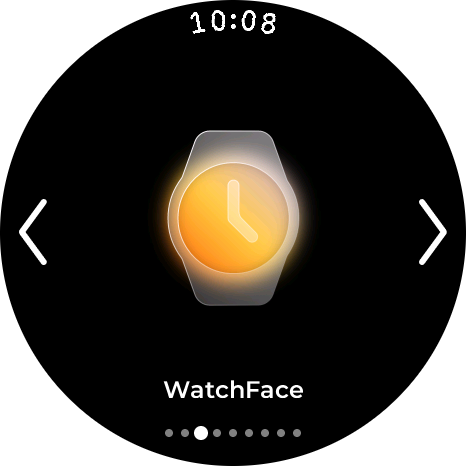 | 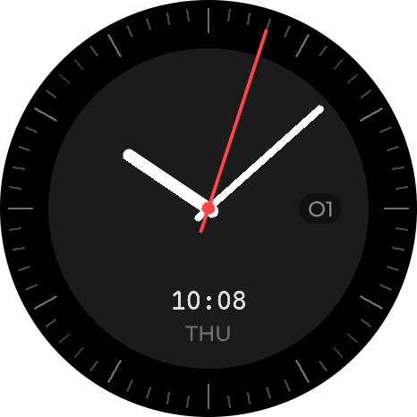 | 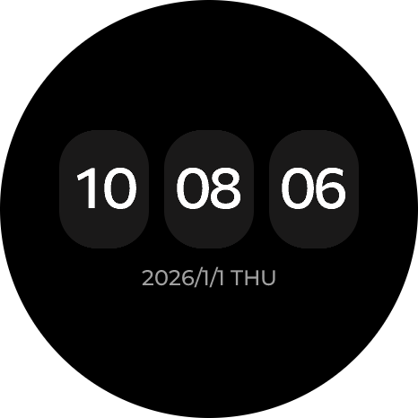 |
| **大数字表盘** | **秒表与计圈** | **幸运转盘** |
|  | 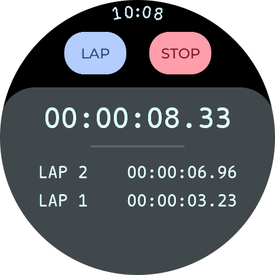 |  |

### StickS3

| 主页 | 弹珠迷宫 | 骰子 | 贪吃蛇 | 水平仪 | 声音计 | 节拍器 |
| :---: | :---: | :---: | :---: | :---: | :---: | :---: |
| 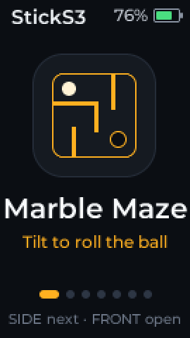 | 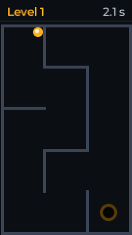 | 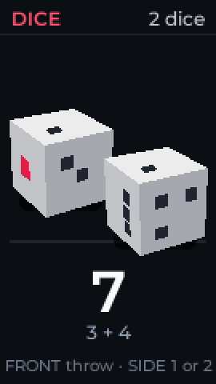 |  | 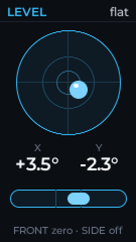 | 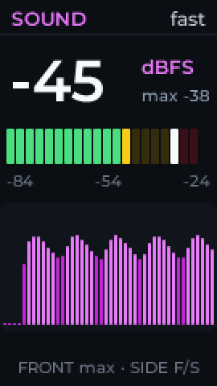 | 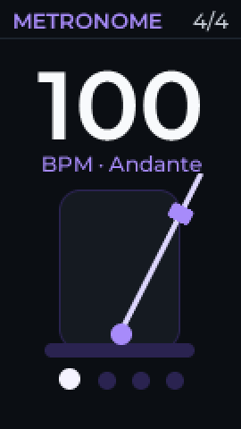 |

### AtomS3

| 菜单 | Wi-Fi 扫描 | I2C 扫描 | UART 监视 | PWM | IMU |
| :---: | :---: | :---: | :---: | :---: | :---: |
|  | 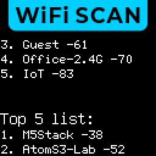 | 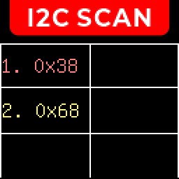 | 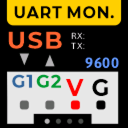 | 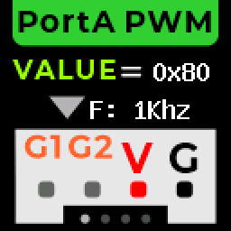 | 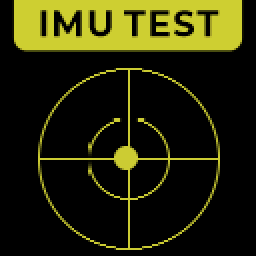 |

## JS 模式与 AOT 模式

两种模式使用同一份 `apps/<board>-*/` 源码，由同一个 PocketJS Rust 核心绘制，
共用同一套板级代码。模式由 Kconfig 选择：`CONFIG_M5_POCKET_APP_MODE_JS`（默认）
或 `CONFIG_M5_POCKET_APP_MODE_AOT`（由各程序的 `sdkconfig.aot` 设置）。

| | JS 模式 | AOT 模式（MicroTS） |
| --- | --- | --- |
| 固件包含什么 | bundle（`.pkb`：JavaScript 与资源包）和 QuickJS 引擎 | MicroTS 由视图和模型生成的 Rust 代码；没有 JavaScript 引擎，也没有 bundle |
| 应用如何运行 | QuickJS 解释执行 bundle；PocketJS 核心负责布局和绘制 | 编译后的应用直接调用 PocketJS 核心 |
| 板级数值与请求（`device.ts`） | `main.tsx` 接入 `globalThis.m5`，每帧调用 `device.ts` 的 host 函数 | 程序的 AOT crate 通过生成的访问器写入 `device.ts` 字段 |
| 触摸 | 由框架的点击识别器处理 | host 把一次接触转换为对其下方可聚焦视图的按压；没有手势和滚动事件 |
| 图片 | 位于 bundle 的资源包中 | 烘焙进 flash；按程序不同，在首次绘制时解码，或在启动时复制到堆中 |
| 内存 | QuickJS 堆，有 PSRAM 的开发板从 PSRAM 分配（上限：StickS3 4 MiB、StopWatch 6 MiB、Tab5 24 MiB） | 没有 QuickJS 堆；无需 PSRAM |
| 构建 | `pocket compile` 生成 bundle；PocketJS 运行时归档从源码构建 | `pocket compile --aot` 生成 Rust；Cargo 构建程序的 `aot/` crate |
| 能否在 PocketJS 模拟器和浏览器 host 中运行 | 能，使用同一个 bundle | 不能；可预览同一份源码的 JS 构建 |

应用镜像大小（ESP-IDF 6.2，数据来自各程序的 README）：

| 开发板 | JS 模式 | AOT 模式 | 差异 |
| --- | ---: | ---: | ---: |
| Tab5 | 7,429,296 B | 6,411,168 B | −14 % |
| StopWatch | 11,342,848 B | 10,621,248 B | −6 % |
| StickS3 | 2,893,952 B | 1,860,944 B | −36 % |
| AtomS3 | 无法启动（内部 RAM 不足） | 2,092,432 B | — |

在 Tab5 和 StopWatch 的镜像中，两种模式下图片都占了很大一部分（约 3.5 MB 和
7 MB），因此 AOT 模式节省的比例小于 StickS3；StickS3 的界面全部由视图绘制。

**如何选择模式。** JS bundle 可以不经修改地在 PocketJS 模拟器和浏览器 host 中运行，
适合迭代界面。AOT 模式的镜像更小，不需要 JavaScript 堆，也是 AtomS3 唯一能
容纳的模式。

**源码约束。** 为了让两种模式都能构建，应用源码限定在 MicroTS 的准入子集内：
模型是 TypeScript 状态模块，包含带类型的顶层字段和同步函数；视图是符合
[MicroTS Solid 子集](https://github.com/pocket-nexus/pocketjs/blob/484a310010dedb9e1daf211f0fda20cf4029a65a/site/content/docs/microts-solid.md)
的 Solid TSX。拖动、滑动等手势由模型代码实现，读取 host 发布的 `pointerX`、
`pointerY` 和 `pointerDown` 字段，因此在两种模式下行为一致。无需构建固件即可
检查改动是否在子集之内：

```sh
bun run pocket compile --config apps/stopwatch-factory/pocket.host.config.ts --aot --out /tmp/stopwatch-aot
```

[docs/APP-HOST.md](docs/APP-HOST.md) 说明了 host 如何运行每种模式，以及程序的
AOT crate 如何构建。

## 烧录发布的固件

每个 [Release](https://github.com/pocket-nexus/m5stack-firmware/releases) 都为
每块开发板的每种模式提供一个合并后的 flash 镜像
`m5stack-firmware-<board>-<js|aot>-<version>.bin`，其中包含 bootloader、分区表和
应用。用 [esptool](https://github.com/espressif/esptool) 写入偏移 0x0：

```sh
esptool --chip esp32p4 write-flash 0x0 m5stack-firmware-tab5-js-v0.1.2.bin       # Tab5
esptool --chip esp32s3 write-flash 0x0 m5stack-firmware-stopwatch-aot-v0.1.2.bin # StopWatch
esptool --chip esp32s3 write-flash 0x0 m5stack-firmware-sticks3-js-v0.1.2.bin    # StickS3
esptool --chip esp32s3 write-flash 0x0 m5stack-firmware-atoms3-aot-v0.1.2.bin    # AtomS3, AtomS3R
```

[CHANGELOG.md](CHANGELOG.md) 列出了每个版本的镜像和变更。

## 从源码构建

### 环境要求

| 工具 | 版本 | 用途 |
| --- | --- | --- |
| [ESP-IDF](https://docs.espressif.com/projects/esp-idf/) | `>=6.0,<6.3`（CI 使用 6.2） | 固件 |
| [Bun](https://bun.sh) | `.bun-version` 中的版本 | Pocket CLI、bundle、git hooks |
| 通过 [rustup](https://rustup.rs) 安装的 Rust | 1.98.1，含 `riscv32imafc-unknown-none-elf` 和 `wasm32-unknown-unknown` | ESP32-P4 的 PocketJS 运行时与 AOT 库；MicroTS 布局 oracle（AOT 构建、模拟器） |
| 乐鑫 Rust 工具链 `esp`（[espup](https://github.com/esp-rs/espup)） | Xtensa Rust 1.97.0.0 | ESP32-S3 的 PocketJS 运行时与 AOT 库 |

两种模式都需要 Rust：固件会从子模块源码构建 PocketJS 运行时。构建时会把 Xtensa
工具链当作 rustup 工具链 `esp`（`~/.rustup/toolchains/esp`）来查找，
`espup install --toolchain-version 1.97.0.0` 正是安装到这个位置。

```sh
rustup toolchain install 1.98.1 --target riscv32imafc-unknown-none-elf --target wasm32-unknown-unknown
espup install --toolchain-version 1.97.0.0     # ESP32-S3 开发板需要
```

### 克隆与安装

```sh
git clone --recurse-submodules https://github.com/pocket-nexus/m5stack-firmware.git
cd m5stack-firmware
bun install                 # JavaScript 依赖和 git hooks
. $IDF_PATH/export.sh
```

### 构建与烧录

| 开发板 | 目录 | IDF target | 模式 |
| --- | --- | --- | --- |
| Tab5 | `programs/tab5` | `esp32p4` | JS、AOT |
| StopWatch | `programs/stopwatch` | `esp32s3` | JS、AOT |
| StickS3 | `programs/sticks3` | `esp32s3` | JS、AOT |
| AtomS3 | `programs/atoms3` | `esp32s3` | AOT（其 `sdkconfig.defaults` 的默认值） |

JS 模式，构建目录 `build/`：

```sh
cd programs/<board>
idf.py set-target <target> build
idf.py -p <port> flash monitor
```

AOT 模式，构建目录 `build-aot/`：

```sh
cd programs/<board>
idf.py -B build-aot -DSDKCONFIG=build-aot/sdkconfig \
    -DSDKCONFIG_DEFAULTS="sdkconfig.defaults;sdkconfig.aot" set-target <target> build
idf.py -B build-aot -DSDKCONFIG=build-aot/sdkconfig -p <port> flash monitor
```

对 AtomS3 而言，`build/` 的命令构建的就是 AOT 模式：它的 `sdkconfig.defaults`
选择了 AOT，且没有 `sdkconfig.aot`。注意事项：

- 第一次 AOT 构建会在 `third_party/pocketjs` 中运行 `bun tools/wasm.ts`，构建
  MicroTS 布局 oracle（`pocketjs.wasm`，属于被忽略的构建产物）。
- 同一程序的 JS 与 AOT 构建共用 `managed_components/`，但使用不同的锁文件
  （`dependencies.lock`、`dependencies.aot.lock`）：请依次构建，不要同时进行。
- StopWatch 的 AOT 构建会由 MicroTS 生成约 100 MB 的 Rust 模块，rustc 编译它
  需要 10 GB 以上内存；CI 任务为此额外添加 8 GB swap 文件，耗时约 25 分钟。
- 在 `menuconfig` 中切换模式后，运行 `idf.py reconfigure`。

各程序的 README 给出了开发板引脚、分区表和实测大小。

## 无开发板预览

JS bundle 可以在 PocketJS 模拟器（wasm 核心）中运行，上面的截图就是这样渲染的：

```sh
(cd third_party/pocketjs && bun tools/wasm.ts)   # 只需一次：构建 wasm 核心
bun tools/screenshots.ts                         # 全部开发板，或指定：tab5 stopwatch sticks3 atoms3
```

该工具把每个应用编译到 `.pocket-build/screenshots/`，按预设流程操作界面，
并写出 `docs/images/<board>-<screen>.png`。没有开发板时，各应用会模拟设备数值；
一个替代 host 中 `globalThis.m5` 的桩对象负责传入流程设定的按键和传感器数值。

## 工作原理

```text
apps/<board>-*/            TSX 视图、TS 模型、device.ts、字体、图片
      │
      ├─ JS 模式：  tools/pocket compile ──────► bundle (.pkb) ─► QuickJS guest ─┐
      └─ AOT 模式： tools/pocket compile --aot ► Rust ─► programs/<board>/aot ───┤
                                                                                 ▼
platforms/esp-idf/m5_pocket_app    应用 host：显示、渲染器、输入、帧循环、设备桥
      │
programs/<board>/main              开发板初始化、发布传感器数据、处理请求
      │
platforms/esp-idf/m5_bsp_<board>   取自 M5Stack 源码的板级支持
```

- **板级支持**（`m5_bsp_<board>`）负责初始化电源、总线、屏幕、触摸、按键、
  传感器和音频，并返回 ESP-IDF 句柄。它不依赖 PocketJS。
- **应用 host**（`m5_pocket_app`）把屏幕和输入封装成 PocketJS 的显示与输入驱动，
  在独立任务中以所选模式运行应用，并在每帧前后调用程序的钩子函数。
- **设备桥**按名称传递数值：程序调用
  `m5_pocket_bridge_set_number("batteryLevel", 76)`，应用读取 `device.ts` 中的
  `batteryLevel` 字段。应用以字符串形式发送请求，例如
  `request("brightness 80")`，由程序的 `on_request` 钩子处理。

## 仓库结构

```text
apps/                     四个应用（TSX/TS 源码、字体、图片）
programs/<board>/         ESP-IDF 工程：main、sdkconfig.defaults、分区表、AOT crate
platforms/esp-idf/        板级支持组件和共享的应用 host
platforms/rust/           AOT 模式共享的 Rust crate
third_party/pocketjs/     PocketJS（git 子模块）
tests/                    aot-smoke 程序（两种模式、两种 target）、字体检查
tools/                    Pocket CLI 启动脚本、格式化、截图、帧剖析工具
docs/                     参考文档
```

`third_party/pocketjs` 固定在
[pocket-nexus/pocketjs](https://github.com/pocket-nexus/pocketjs) 的提交
`484a3100`，位于 `v0.17.0` 发布之后。

## 已知限制

- Tab5：没有摄像头预览（摄像头窗口保持黑屏）、Wi-Fi 热点（窗口只显示出厂文字）
  和 USB-A host。
- StopWatch：没有 Wi-Fi station 模式和配网热点（徽章编辑器自带热点）；
  FluidBox 模拟 48 个粒子，出厂固件为 450 个。JS 镜像在开发板上无法启动
  （见 [programs/stopwatch](programs/stopwatch/README.md#validation)），请烧录
  AOT 镜像。
- PocketJS 只在一组固定字号（10 到 54 px）上烘焙字体，因此出厂固件中其他字号的
  文字改用最接近的字号，或用出厂固件的字形位图绘制（[docs/FONTS.md](docs/FONTS.md)）。

## 文档

| 文档 | 内容 |
| --- | --- |
| [docs/STRUCTURE.md](docs/STRUCTURE.md) | 仓库结构与职责划分 |
| [docs/APP-HOST.md](docs/APP-HOST.md) | 应用 host：JS 与 AOT 模式、C API、设备桥、AOT crate |
| [docs/FONTS.md](docs/FONTS.md) | 各应用的字体、字号与字体图集预算 |
| `programs/<board>/README.md` | 开发板参数、组成、构建命令、大小 |
| `apps/<app>/README.md` | 界面、操作、设备桥字段、与出厂固件的差异 |
| `platforms/esp-idf/m5_bsp_<board>/README.md` | 板级支持及其所取自的 M5Stack 源码 |

各程序、应用和组件的 README 以及 `docs/` 下的文档为英文。

## 参与贡献

欢迎提交 Issue 和 Pull Request。工程约定见 [AGENTS.md](AGENTS.md)，要点如下：

- 提交信息遵循 Conventional Commits 格式 `type(scope): summary`，scope 为改动的
  目录（如 `feat(stopwatch-factory): ...`）。`bun install` 会安装 git hooks
  （lefthook）：对提交信息运行 commitlint，对暂存的 C/C++ 文件运行 clang-format。
- C 和 C++ 使用 `package.json` 中固定版本的 clang-format 格式化；推送前请运行
  `bun run format:check`。
- 应用源码保持在 MicroTS 子集之内，以保证两种模式都能构建。
- 对 PocketJS 的修改先合入上游
  [pocket-nexus/pocketjs](https://github.com/pocket-nexus/pocketjs)，再在本仓库
  更新子模块。
- Pull Request 需说明验证方式：执行的命令、结果，以及真机运行时的开发板版本。

## 许可证

[MIT](LICENSE)。取自 M5Stack、乐鑫和 Bosch Sensortec 源码的文件保留其原有的
版权与许可证（MIT、Apache-2.0、BSD-2-Clause、BSD-3-Clause）。字体的许可证放在
各自的 `apps/<app>/fonts/` 目录中：Montserrat、Maple Mono 和 Commissioner
（SIL Open Font License 1.1），以及 efont（BSD 风格）。
